# Capturas de Pulse · escritorio y móvil

Las seis secciones de Pulse en escritorio y móvil, más la pantalla Coche en tema claro. Cada pareja permite comparar cómo se adapta la misma interfaz al ancho disponible.

Esta galería procede de una instancia local con datos de prueba. La etiqueta visible «Lucas» no identifica una sesión de la instalación privada. No contiene telemetría ni datos privados de un B10; las coordenadas de Mapa son valores de ejemplo públicos del producto. La ilustración del coche es orientativa.

Las capturas de escritorio se conservan sin cambios. Las móviles se han tomado con un viewport de navegador de 390 × 844 px; el contenido dispone de 375 px de ancho por la barra de desplazamiento. La exportación del navegador genera JPEG de 375 × 812 px. Son capturas del área visible, sin retoques, y no imágenes de un iPhone ni de una aplicación nativa instalada.

Estas imágenes documentan el aspecto de la interfaz; no demuestran funcionamiento con un vehículo, sensores, cámaras, centinela, servicios externos ni pruebas físicas en teléfonos. Puedes abrir cada imagen para verla a su tamaño original.

## Coche · tema oscuro

| Escritorio | Móvil |
| --- | --- |
| 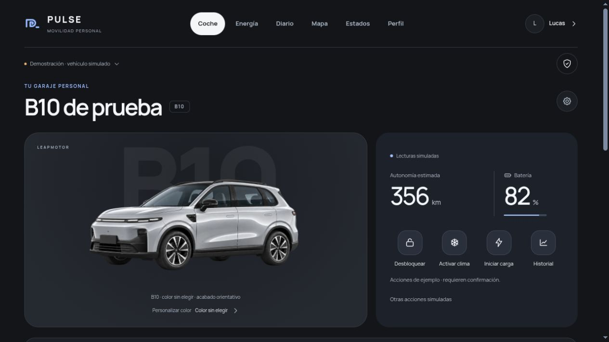 | 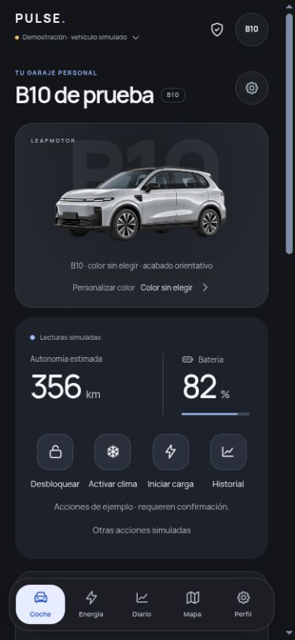 |

## Energía

| Escritorio | Móvil |
| --- | --- |
| 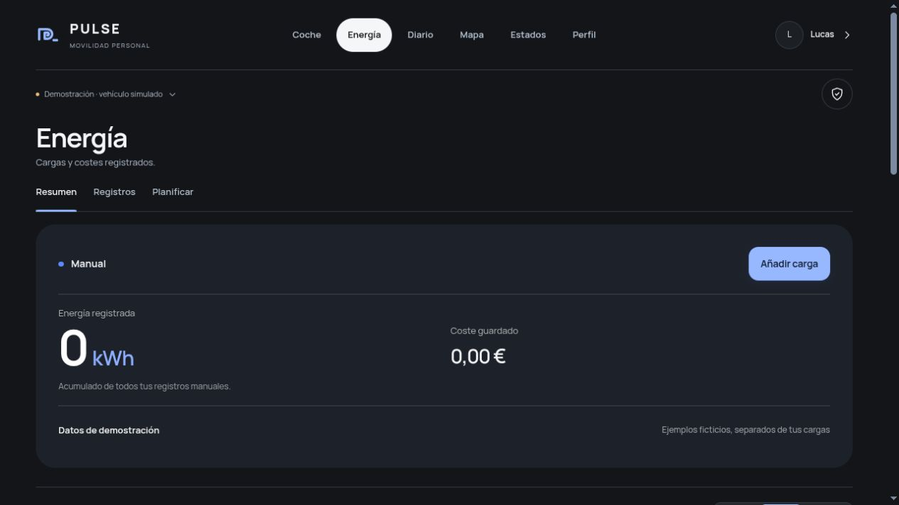 | 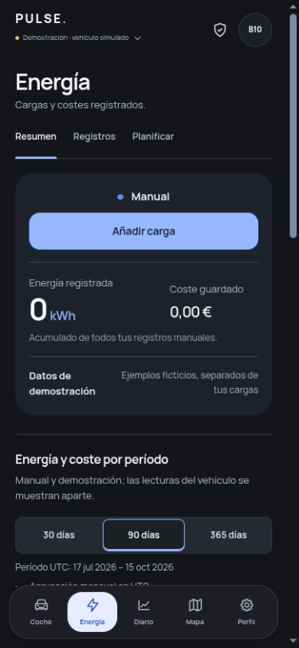 |

## Diario

| Escritorio | Móvil |
| --- | --- |
| 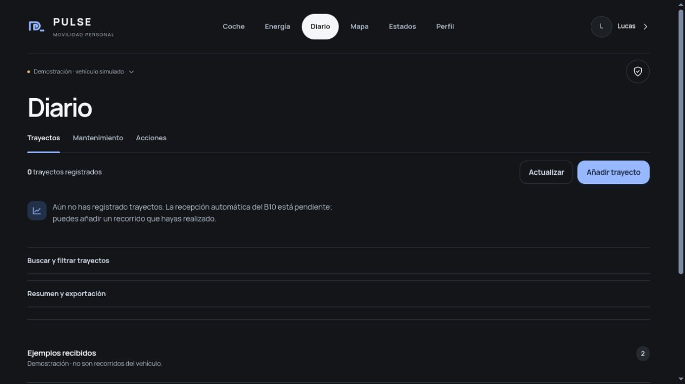 | 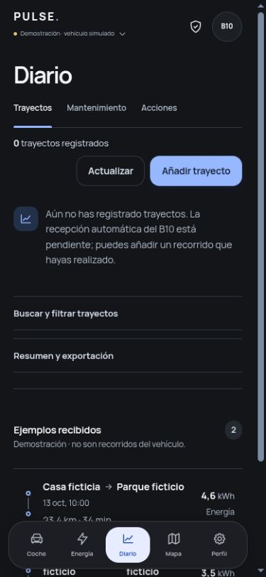 |

## Mapa

| Escritorio | Móvil |
| --- | --- |
| 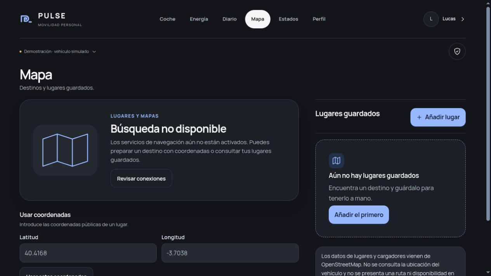 | 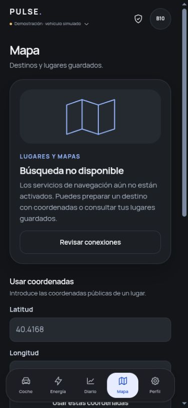 |

## Estados

| Escritorio | Móvil |
| --- | --- |
| 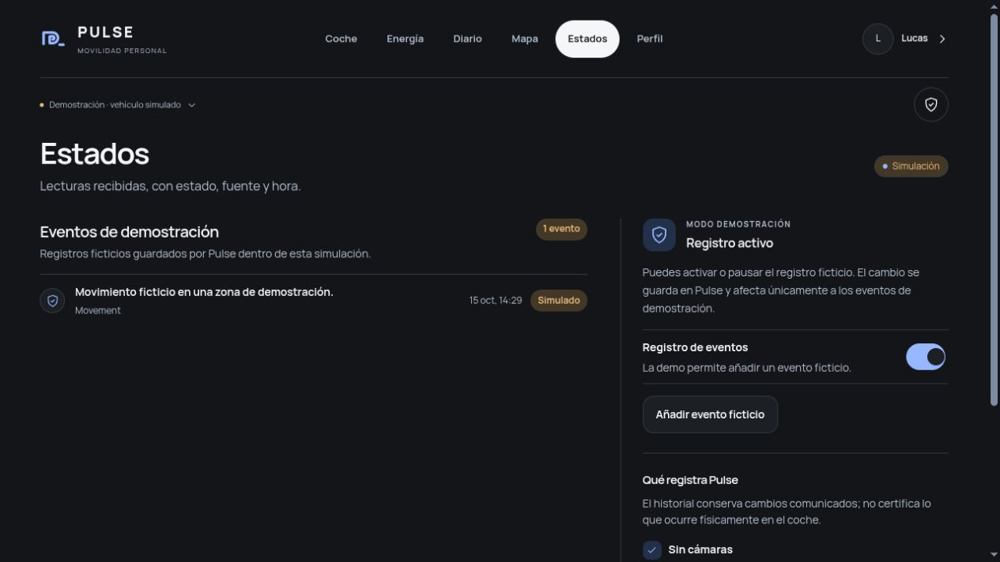 | 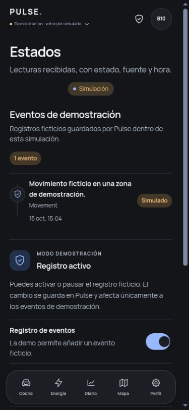 |

## Perfil

| Escritorio | Móvil |
| --- | --- |
| 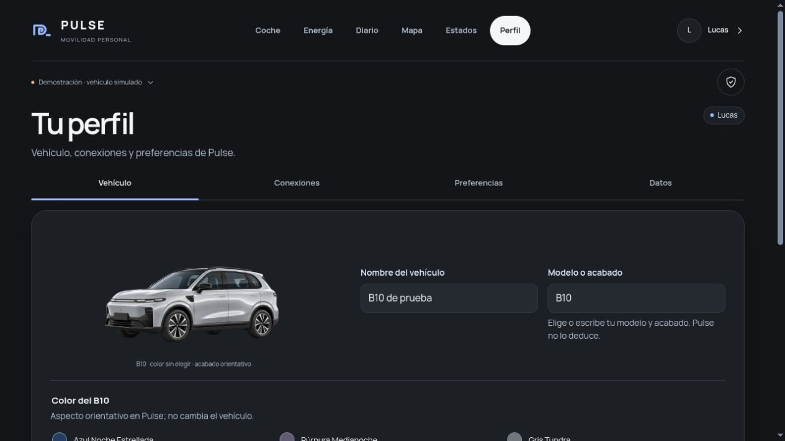 | 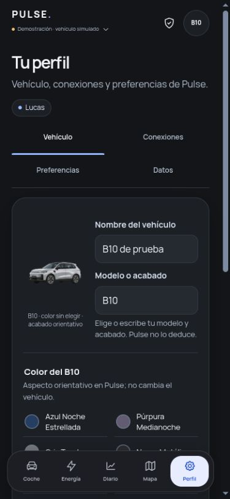 |

## Coche · tema claro

| Escritorio | Móvil |
| --- | --- |
| 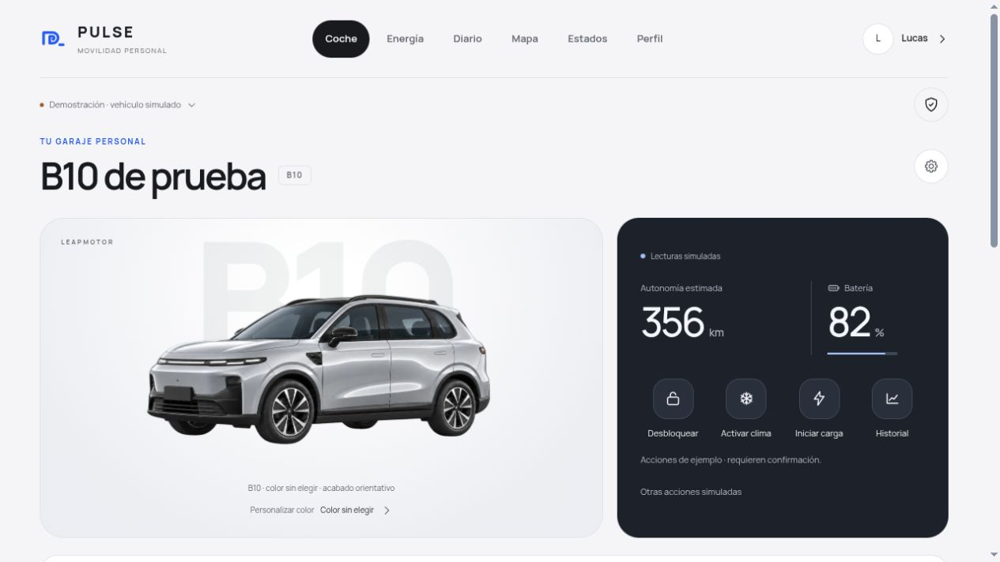 | 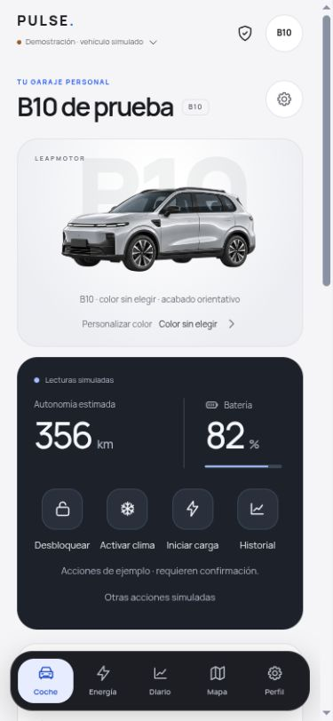 |
